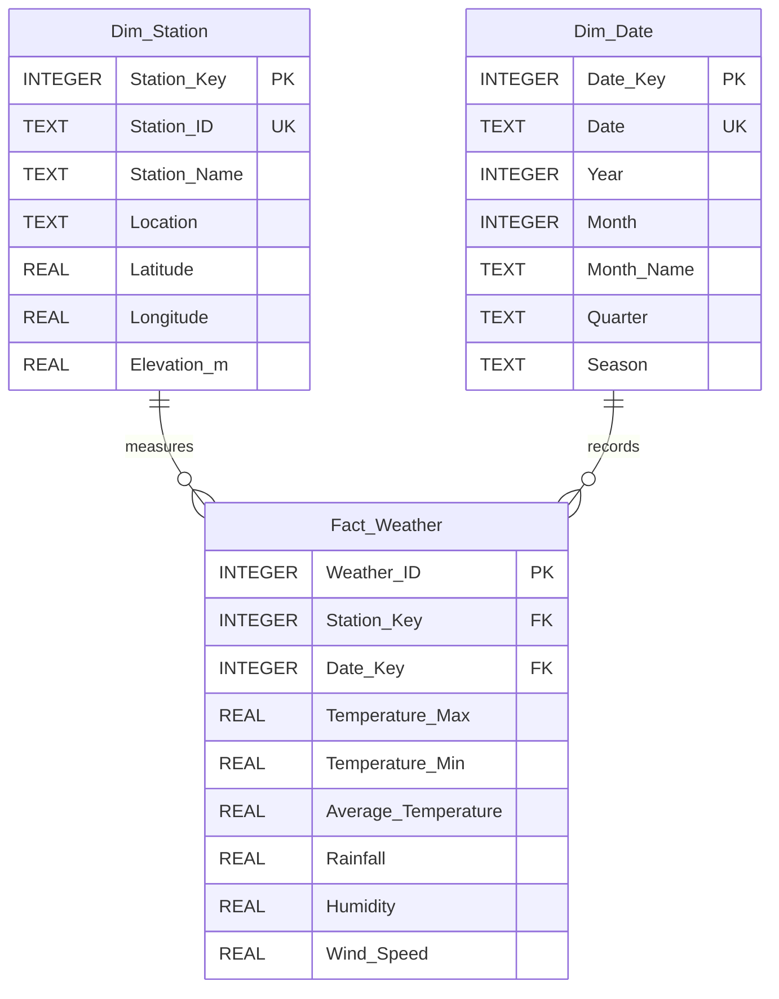

# 🌍 ClimateTrend AI

**An Intelligent System to Consolidate Decades of Station Data for Trend Dashboards**

[](https://www.python.org/)
[](https://streamlit.io/)
[](https://www.sqlite.org/)
[](https://opensource.org/licenses/MIT)

---

## 📌 1. Project Abstract
The proposed system introduces a **time-series data-warehouse design to consolidate decades of station data for trend dashboards**, addressing the problem of weather-data warehousing for climate trend analysis through a data-driven approach. The system is trained and validated using meteorological department archives, with preprocessing and feature engineering steps tailored to the domain. The final deliverable is an interactive climate-research dashboard aimed at making the solution usable by real stakeholders (climatologists, policy makers, agricultural departments, and urban planners).

**Keywords**: Weather, Data, Warehousing, Climate, Trend, Analysis.

---

## 🏛️ 2. Data Warehouse Architecture (Star Schema)

The core data repository uses a dimensional Star Schema implemented in SQLite, optimized for multi-decadal time-series queries.



---

## 📁 3. Project Structure

```
climate_trend_ai/
│
├── app.py                      # Main Streamlit Entry Point (Executive Dashboard)
├── config.py                   # Global Configuration, Paths & Station Metadata
├── requirements.txt            # Python Dependencies
├── README.md                   # Comprehensive Technical & Deployment Guide
├── .gitignore                  # Git Version Control Exclusions
│
├── data/
│   ├── raw/                    # Raw Uploaded Datasets Archive
│   ├── processed/              # Cleaned & Engineered CSV Exports
│   └── sample_weather_data.csv # 20-Year Synthetic Benchmark Demonstration Dataset
│
├── database/
│   └── warehouse.db            # SQLite Star Schema Warehouse Database
│
├── models/
│   └── climate_model.pkl       # Serialized Machine Learning Model Bundle
│
├── modules/
│   ├── data_loader.py          # Synthetic Generator & CSV Ingestion Engine
│   ├── data_cleaning.py        # Validation, Deduplication & Imputation
│   ├── feature_engineering.py  # Temporal, Thermodynamic & Anomaly Features
│   ├── etl_pipeline.py         # End-to-End EXTRACT-TRANSFORM-LOAD Orchestrator
│   ├── data_warehouse.py       # Star Schema Tables, DDL & SQL Query Engine
│   ├── analytics.py            # Big Data Statistical Summaries & Climatology
│   ├── prediction.py           # Harmonic Scikit-learn Linear Regression Model
│   └── visualizations.py       # Custom Themed Plotly Interactive Figures
│
├── pages/
│   ├── 1_Data_Upload.py        # CSV Ingestion, Schema Check & ETL Execution
│   ├── 2_Data_Exploration.py   # Multi-filter Slicing, Profiling & Null Audit
│   ├── 3_Climate_Trends.py     # Climatology, Rain Bar, Seasons & Heatmap
│   ├── 4_Predictions.py        # Model Training, Evaluation Metrics & Forecast
│   └── 5_About_Project.py      # Abstract, Architecture & Academic Overview
│
├── assets/
│   └── style.css               # Modern Dark Navy & Climate Green UI Styling
│
└── tests/
    └── test_project.py         # Automated Pytest Validation Suite
```

---

## ⚡ 4. Automatic Quickstart & Installation

### Step 1: Clone or Navigate to Project
```bash
cd d:\mini_project
```

### Step 2: Create & Activate Virtual Environment
**On Windows:**
```powershell
python -m venv venv
.\venv\Scripts\activate
```

**On Linux / macOS:**
```bash
python3 -m venv venv
source venv/bin/activate
```

### Step 3: Install Required Dependencies
```bash
pip install --upgrade pip
pip install -r requirements.txt
```

### Step 4: Run the Application
```bash
streamlit run app.py
```
Open your browser at `http://localhost:8501`.

---

## 🧪 5. Running Automated Tests

Run the full pytest suite covering data loading, cleansing, ETL, Star Schema insertion, analytical metrics, and ML model training:
```bash
pytest -v tests/test_project.py
```

---

## 🖥️ 6. Dashboard Pages Overview

1. **Executive Dashboard (`app.py`)**:
   - 6 High-level KPI metric cards (Total Records, Stations, Timespan, Mean Temp, Total Rain, Humidity).
   - Decadal temperature trajectory with 12-month moving average ribbon.
   - Annual precipitation trend bar chart.
   - Cross-station benchmark comparison and climatological insights.

2. **Data Upload & ETL (`pages/1_Data_Upload.py`)**:
   - CSV upload support for custom historical station data.
   - Schema validation against 8 meteorological dimensions.
   - One-click EXTRACT-TRANSFORM-LOAD pipeline execution.
   - Export and download of cleaned and engineered dataset.

3. **Data Exploration (`pages/2_Data_Exploration.py`)**:
   - Multi-dimensional filters (Station multi-select, Year range slider, Month multi-select).
   - Descriptive statistical summaries (`mean`, `std`, `min`, `max`, percentiles).
   - Inter-variable correlation heatmap and data quality null audit.

4. **Climate Trends (`pages/3_Climate_Trends.py`)**:
   - Monthly climatological cycle (dual-axis temperature and rainfall).
   - IMD seasonal comparisons (Winter, Summer, Monsoon, Post-Monsoon).
   - Atmospheric dynamics (Humidity vs. Wind Speed).
   - Monthly temperature anomaly heatmap ($Year \times Month$).

5. **Predictions & Modeling (`pages/4_Predictions.py`)**:
   - Train/retrain Scikit-learn Linear Regression model on demand.
   - Evaluation metrics: **MAE**, **MSE**, **RMSE**, and **$R^2$ Score**.
   - Actual vs. Predicted scatter plot with $1:1$ ideal fit line.
   - Future 1-to-10 year monthly temperature forecasts clearly demarcated as `ESTIMATED_PREDICTION`.

6. **About Project (`pages/5_About_Project.py`)**:
   - Comprehensive documentation of project background, problem statement, objectives, Star Schema DDL, technology stack, and future enhancements.

---

## 🌐 7. Deployment Instructions (GitHub & Streamlit Community Cloud)

Follow these exact steps to publish **ClimateTrend AI** to the web:

### Step A: Push Project to GitHub
1. Initialize git inside your project folder:
   ```bash
   git init
   git add .
   git commit -m "Initial commit: ClimateTrend AI full-stack system"
   ```
2. Create a new public repository on [GitHub](https://github.com/new) named `climate-trend-ai`.
3. Link your local project to GitHub and push:
   ```bash
   git branch -M main
   git remote add origin https://github.com/<YOUR_GITHUB_USERNAME>/climate-trend-ai.git
   git push -u origin main
   ```

### Step B: Deploy to Streamlit Community Cloud
1. Sign in to [Streamlit Community Cloud](https://share.streamlit.io/) with your GitHub account.
2. Click **Create app** -> **Deploy a public app from GitHub**.
3. Configure the deployment settings:
   - **Repository**: `<YOUR_GITHUB_USERNAME>/climate-trend-ai`
   - **Branch**: `main`
   - **Main file path**: `app.py`
4. Click **Deploy!**
5. Streamlit Community Cloud will automatically build the container, install packages from `requirements.txt`, and deploy your live dashboard.
6. Once deployed, copy and share your live public URL (e.g., `https://climatetrend-ai.streamlit.app`).
